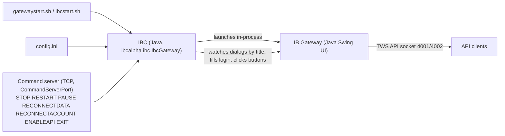
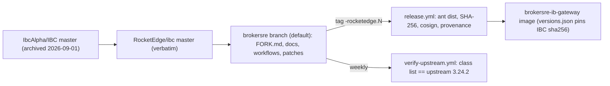

# Architecture

## IBC process model (as shipped by upstream)

## Fork and patch flow

The build needs the IB Gateway jars on the classpath (`IBC_BIN`); CI downloads the current
stable installer from IBKR for that purpose only. No IBKR binary is redistributed from here.
